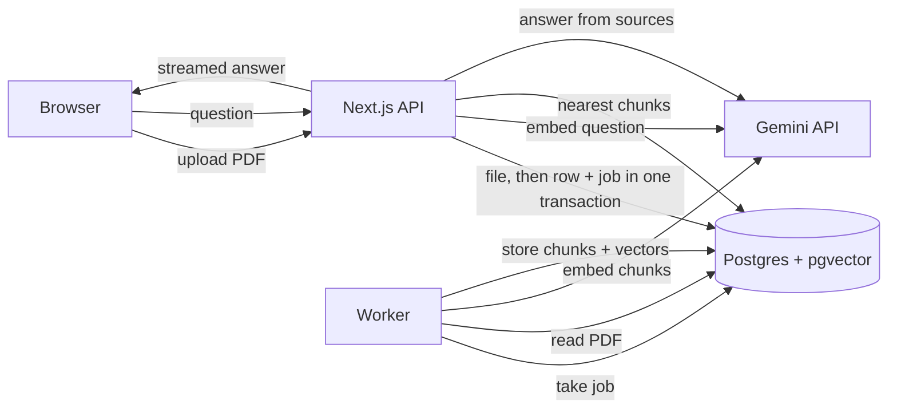

# Study Assistant

Upload lecture PDFs, ask questions about them, and get answers that cite the exact page they came from. It can also turn a lecture into a multiple-choice quiz.

Answers come only from your own notes. If the notes don't cover a question, the app says so instead of guessing.

## Features

- **Cited answers.** Every claim in an answer is tagged `[1]`, `[2]`, … Clicking a tag shows the passage it came from and links to that page of the PDF.
- **Streaming chat with history.** Answers appear as they're written. Past conversations are saved per course.
- **Quizzes.** Generates up to 8 questions spread across a whole lecture, with explanations and page references.
- **Background processing.** Uploads return immediately; a separate worker extracts, chunks and embeds the PDF, and the page updates on its own.

## How it works



**Uploading a PDF**

1. The API checks the file: at most 5 MB, and the first bytes must be `%PDF`. The filename and the browser's content type can't be trusted, so they aren't used for this check.
2. The file is saved (in Postgres, see below), then the `documents` row and an `ingest-document` job are inserted **in one transaction**. Either both exist or neither does, so a document can never be stuck without a job.
3. The worker extracts text page by page, cleans it up (rejoins words hyphenated across line breaks, normalises whitespace and ligatures), and splits each page into overlapping chunks.
4. The chunks are embedded with Gemini (768 dimensions, 100 per request). The document's old chunks are deleted and the new ones inserted in one transaction. A retried job therefore ends with exactly one set of chunks.
5. Scanned, password-protected, damaged and over-long PDFs fail straight away with a clear message, without wasting retries.

**Asking a question**

1. The question is embedded, and pgvector finds the 6 nearest chunks, filtered to that user and course.
2. Chunks further than a cosine distance of 0.45 are dropped. If none are left, the app replies that the answer isn't in the notes **and doesn't call the model at all**.
3. Otherwise, the chunks go to the model as numbered sources, with instructions to answer only from them and cite each one.
4. The answer streams back together with its sources. Only the sources it actually cites are saved with the message.

**Making a quiz**

About 8 chunks are picked evenly across the document. The model returns JSON that's validated against a zod schema (exactly 4 options, a valid answer index, a real source). Each question's options are shuffled, because models tend to put the right answer first.

## Design decisions

- **pgvector instead of a separate vector database.** Chunks, their vectors and their owners live in one place. Retrieval can filter by user and course in the same query, and there's one fewer service to run. An HNSW index keeps the search fast, with iterative scans enabled so the user/course filter can't starve the top-6 results.
- **768-dimension embeddings.** `gemini-embedding-001` outputs 3,072 dimensions by default, but pgvector's HNSW index supports at most 2,000. The model is trained so the leading dimensions carry most of the meaning, so 768 costs little quality and uses a quarter of the storage.
- **Different embedding modes for chunks and questions.** Chunks are embedded as `RETRIEVAL_DOCUMENT` and questions as `RETRIEVAL_QUERY`. A question and the passage that answers it are phrased differently, and this lets the model match them anyway.
- **A job queue in Postgres (pg-boss).** It needs no Redis. Workers claim jobs with `FOR UPDATE SKIP LOCKED`, so two workers never take the same job. Failed jobs retry three times with exponential backoff; Gemini rate limits are also retried inside the call, using the delay Gemini asks for.
- **Chunks of ~2,000 characters with ~300 overlap, never crossing a page.** That's about 500 tokens: small enough to stay on one topic, and each chunk has exactly one page number for citations. Chunks end at a paragraph break, else a sentence end, else a space.
- **The distance threshold was measured, not guessed.** On a test lecture, the correct page scored 0.28–0.31, other pages of the same lecture 0.39–0.46, and off-topic questions 0.51 or more. 0.45 separates them. It can be tuned with `RETRIEVAL_MAX_DISTANCE`.
- **Access control lives in the queries.** Every data function takes the user's id and includes it in the `WHERE` clause. Someone else's course returns 404 rather than 403, so the response doesn't confirm that the id exists.
- **PDFs are stored in Postgres.** Free hosts wipe their disk on restart, and with a 5 MB cap a `bytea` column is simpler than adding an object store. All file access goes through `src/lib/storage.ts`, so moving to S3 or R2 later would change that one file.
- **The server owns the chat history.** The browser sends only the new question; earlier turns are loaded from the database, so a client can't rewrite what the model sees.

## Stack

Next.js 16 (App Router) · TypeScript · Tailwind · Postgres 17 + pgvector · Drizzle ORM · pg-boss · Better Auth (Google login) · Gemini (`gemini-embedding-001`, a Flash-Lite chat model) · Vercel AI SDK · zod · unpdf · Vitest

## Running locally

Requirements: Node 24+, Docker, a Gemini API key ([Google AI Studio](https://aistudio.google.com)), and a Google OAuth client.

```bash
npm install
cp .env.example .env.local      # then fill in the values (see comments in the file)
npm run db:up                   # Postgres + pgvector in Docker
npm run migrate                 # create the tables
npm run check:gemini            # lists the models your key can use; set GEMINI_*_MODEL from it
```

For the Google OAuth client, add `http://localhost:3000/api/auth/callback/google` as an authorized redirect URI.

Then run the app and the worker in two terminals:

```bash
npm run dev       # http://localhost:3000
npm run worker    # processes uploaded PDFs
```

## Tests

```bash
npm test
```

71 unit tests cover text cleanup, chunking, scanned-PDF detection, batching, retry and backoff, the Gemini client (with the SDK mocked, so no API calls), prompt and citation parsing, and quiz helpers. PDF extraction is tested against real PDFs generated in the tests.

## Deploying

The production start command (`npm run start:prod`) runs migrations, then starts the web server and the worker in one process group. It needs:

- a Postgres database with the `vector` extension available (Neon's free plan works; use the direct connection string rather than the pooled one, which is the safer choice for migrations and the long-lived worker connection),
- the variables from `.env.example` set in the host's settings, with `BETTER_AUTH_URL` set to the public URL and that URL's `/api/auth/callback/google` added to the OAuth client.

No disk is needed, since files live in the database. It runs on Render's free web service: the instance sleeps after 15 minutes without traffic and takes about a minute to wake, and queued jobs simply wait in Postgres until it does.

## Limitations

- **The threshold was calibrated on a small set** (7 questions, one lecture). It needs a larger evaluation set to tune properly.
- **Vague follow-ups retrieve poorly.** Retrieval only searches the latest question, so "what about it?" doesn't find much. Rewriting the question with the chat history first would fix this.
- **No OCR.** Scanned PDFs are detected and rejected rather than read.
- **Files live in Postgres.** Fine at this scale; a large deployment would move them to object storage.
- **No per-user usage limits** yet, so a heavy user can exhaust the free-tier Gemini quota.

## Project structure

```
src/
  app/            pages and API routes (courses, documents, chat, quizzes, auth)
  components/     chat UI, header, sign-in and sign-out
  db/             Drizzle schema (app tables + Better Auth tables)
  lib/            data access, retrieval, Gemini client, chunking, prompts, quizzes
worker/           background worker that ingests PDFs
drizzle/          SQL migrations
scripts/          setup checks, migrations, production start
```
